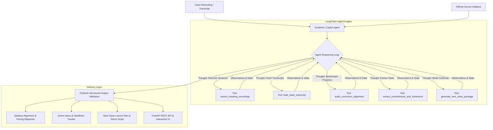

# 🎓 Academic Copilot Agent
### Autonomous Multi-Tool LangChain Agent for Meeting Ingestion, Syllabus Alignment Auditing & Educational Material Synthesis

[](https://www.python.org/downloads/)
[](https://python.langchain.com/)
[](https://fastapi.tiangolo.com/)
[](https://docs.pydantic.dev/)
[]()
[](https://opensource.org/licenses/MIT)

> An end-to-end, production-grade **Autonomous AI Agent** designed to automate academic operations. It ingests recorded classes, audits pedagogical pacing against official course roadmaps, extracts student commitments and deadlines from natural conversation, and autonomously drafts next-class lesson plans and Python demonstration code.

---

## 🌟 Real-World Problem Solved
Instructors, universities, and coding bootcamps struggle with three recurring bottlenecks:
1. **Curriculum Drift & Pacing Lag:** Instructors often run out of time on complex topics without realizing how far behind schedule they are relative to the official course syllabus.
2. **Lost Commitments:** Homework extensions, student questions, and grading promises agreed upon verbally during 2-hour live calls get forgotten.
3. **High Preparation Friction:** Designing follow-up class scripts and exercises to catch up on delayed concepts takes hours of manual work.

**Academic Copilot Agent** acts as an autonomous teaching assistant that continuously listens to class sessions, benchmarks progress against the curriculum, and synthesizes pedagogical continuity materials.

---

## 🏗️ Architecture & Agent Flow

The agent is built on **LangChain's Tool-Calling Graph Architecture**, combining structured tools, dynamic reasoning loops, and Pydantic validation:



---

## 🧠 LangChain Concepts Demonstrated

* **Agent Graph & Tool Calling:** Implemented with LangChain's latest agent factory (`create_agent`) with tool invocation loops and state propagation.
* **Custom Structured Tools (`@tool`):** Five domain-specific tools with strict input schemas and type validation.
* **ReAct Reasoning Traces:** Full intermediate step visibility:
  $$\text{Thought} \longrightarrow \text{Action (Tool)} \longrightarrow \text{Observation} \longrightarrow \text{Final Answer}$$
* **Structured Output Parsing:** Enforced via Pydantic v2 schemas (`ClassAuditReport`, `SyllabusPacingDiagnosis`, `NextClassLessonPlan`).
* **Zero-Friction Dual Execution Modes:**
  * **Simulation / Mock Mode (Default):** Runs immediately with realistic sample datasets without requiring API keys or Google Cloud configurations.
  * **Live Mode:** Integrates directly with OpenAI (`gpt-4o-mini`) or Google Gemini (`gemini-2.0-flash`) and Google Drive/Gmail APIs.

---

## 🛠️ Specialized Agent Tools

| Tool Name | LangChain Decorator | Description |
| :--- | :--- | :--- |
| `search_meeting_recordings` | `@tool` | Queries recordings by course keyword, dates, or metadata. |
| `load_class_transcript` | `@tool` | Ingests timestamped speaker dialogues and session summaries. |
| `audit_curriculum_alignment` | `@tool` | Benchmarks dialogue against syllabus; calculates pacing delta (Ahead / On Track / Behind). |
| `extract_commitments_and_homework`| `@tool` | Surfaces student homework deadlines, teacher promises, and pending doubts. |
| `generate_next_class_package` | `@tool` | Generates targeted lesson plans, executable demonstration code, and student lab exercises. |

---

## ⚡ Quickstart (Under 60 Seconds)

### 1. Clone & Setup Environment
```bash
git clone https://github.com/rodrigopazTech/academic-copilot-agent.git
cd academic-copilot-agent

# Create virtual environment
python -m venv venv
# Windows:
venv\Scripts\activate
# Linux/macOS:
source venv/bin/activate

# Install dependencies
pip install -r requirements.txt
```

### 2. Launch the Web Application
```bash
python -m uvicorn app.main:app --reload --port 8000
```
Open your browser at **[http://localhost:8000](http://localhost:8000)** to interact with the Glassmorphism Dashboard.
Interactive OpenAPI / Swagger docs are available at **[http://localhost:8000/docs](http://localhost:8000/docs)**.

---

## 💻 CLI Usage

You can also run the agent directly from the command line:

```bash
# Run full autonomous academic audit
python -m app.cli audit --course "Ciencia de Datos"

# Start interactive terminal chat with the Copilot
python -m app.cli chat
```

---

## ⚙️ Configuration (.env)

Copy the `.env.example` file:
```bash
cp .env.example .env
```

```ini
# Run in instant zero-config mode (No API keys needed)
MOCK_MODE=true

# Or enable Live Mode with your preferred LLM:
# MOCK_MODE=false
# DEFAULT_LLM_PROVIDER=openai
# OPENAI_API_KEY=sk-...
# OPENAI_MODEL_NAME=gpt-4o-mini

# Or Google Gemini:
# GEMINI_API_KEY=AIzaSy...
# GEMINI_MODEL_NAME=gemini-2.0-flash
```

---

## 🧪 Test Suite

The project includes unit and integration tests covering the agent loop, each custom tool, and FastAPI endpoints:

```bash
python -m pytest -v
```

Output:
```text
tests/test_agent.py::test_agent_run_audit_simulation PASSED              [  9%]
tests/test_agent.py::test_agent_chat_query PASSED                        [ 18%]
tests/test_api.py::test_api_health PASSED                                [ 27%]
tests/test_api.py::test_api_get_tools PASSED                             [ 36%]
tests/test_api.py::test_api_run_agent PASSED                             [ 45%]
tests/test_api.py::test_api_chat PASSED                                  [ 54%]
tests/test_tools.py::test_search_meeting_recordings PASSED               [ 63%]
tests/test_tools.py::test_load_class_transcript PASSED                   [ 72%]
tests/test_tools.py::test_audit_curriculum_alignment PASSED              [ 81%]
tests/test_tools.py::test_extract_commitments_and_homework PASSED        [ 90%]
tests/test_tools.py::test_generate_next_class_package PASSED             [100%]

============================= 11 passed in 1.06s ==============================
```

---

## 🐳 Docker Deployment

Run with Docker Compose:
```bash
docker-compose up --build
```
Access the application at `http://localhost:8000`.

---

## 📂 Repository Layout

```
academic-copilot-agent/
├── .github/workflows/ci.yml   # Continuous Integration pipeline
├── app/
│   ├── main.py                # FastAPI entrypoint & static mount
│   ├── config.py              # Pydantic Settings & environment config
│   ├── cli.py                 # Command Line Interface
│   ├── agent/
│   │   ├── core.py            # AcademicCopilotAgent engine
│   │   ├── prompts.py         # System prompts & ReAct instructions
│   │   ├── schemas.py         # Pydantic v2 domain schemas
│   │   └── tools/             # 5 domain-specific LangChain tools
│   ├── api/
│   │   └── routes.py          # REST endpoints
│   ├── static/                # Glassmorphism Web Dashboard
│   └── data/                  # Sample syllabi and transcripts
├── tests/                     # 11 unit & integration tests
├── Dockerfile                 # Container definition
├── docker-compose.yml         # Container composition
├── pyproject.toml             # Project metadata
└── requirements.txt           # Production dependencies
```

---

## 👤 Author
**Rodrigo Paz**
- GitHub: [@rodrigopazTech](https://github.com/rodrigopazTech)
- Email: [contactorodrigopaz@gmail.com](mailto:contactorodrigopaz@gmail.com)

---

## 📄 License
This project is licensed under the [MIT License](LICENSE).
